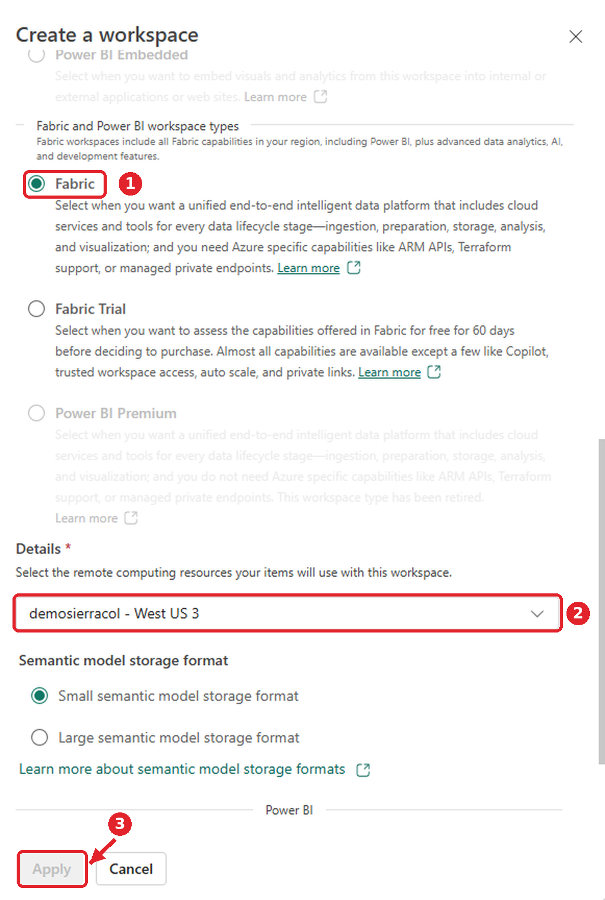
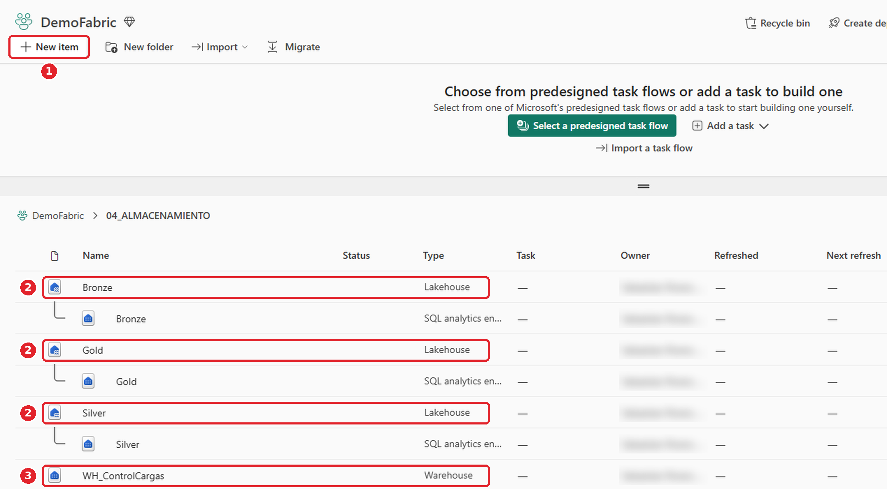

# 🧰 Parte 1 · Preparación del ambiente

En esta parte dejamos listo todo lo que el taller necesita en Microsoft Fabric:

| Paso | Qué haces | Resultado |
|---|---|---|
| [1](#paso-1--crear-el-workspace) | Crear el workspace | Un área de trabajo con capacidad de Fabric |
| [2](#paso-2--organizar-el-workspace-en-carpetas) | Crear las carpetas | El workspace organizado por etapas del flujo |
| [3](#paso-3--crear-los-lakehouses-y-el-warehouse) | Crear los lakehouses y el warehouse | Las capas Bronze, Silver y Gold y el almacén del control de cargas |
| [4](#paso-4--crear-la-tabla-de-control-y-el-log-de-auditoría) | Crear la tabla de control y el log de auditoría | El framework sabe qué cargar y deja registro de cada carga |
| [5](#paso-5--crear-la-fuente-y-subir-los-archivos) | Crear la fuente y subir los archivos | Los CSV disponibles en una carpeta que simula un SFTP |

> Las capturas tienen **números en rojo** que indican el orden de los clics.

---

## Paso 1 · Crear el workspace

1. En la barra lateral izquierda, haz clic en **Workspaces** ①.
2. En la parte inferior del panel, haz clic en **+ New workspace** ②.

<p align="center"></p>

3. En el panel **Create a workspace**:
   - Escribe el **nombre** del workspace (por ejemplo `DemoFabric`) y, si quieres, una descripción.
   - **Domain:** si tu organización usa dominios, selecciona el que corresponda. Si no, déjalo en blanco.
   - Más abajo, en *Fabric and Power BI workspace types*, selecciona **Fabric** ①.
   - En **Details**, elige la **capacidad** que vas a usar ②.
   - Haz clic en **Apply** ③.

<p align="center"></p>

> **¿Por qué "Fabric" y no "Fabric Trial"?** La prueba gratuita dura 60 días y tiene limitaciones. Para el taller usamos la capacidad asignada.

---

## Paso 2 · Organizar el workspace en carpetas

Las carpetas no cambian cómo funciona Fabric, pero ordenan los elementos según la etapa del flujo de datos. Así cualquiera entiende el workspace de un vistazo.

1. Dentro del workspace, haz clic en **New folder** ①.
2. Crea estas carpetas, una por una ②:

| Carpeta | Qué va a contener |
|---|---|
| `00_ORQUESTACION` | Pipelines que coordinan todo el flujo |
| `01_EXTRACCION` | Lo que mueve los archivos desde la fuente |
| `02_TRANSFORMACION` | Notebooks que limpian y transforman (Bronze → Silver → Gold) |
| `03_CARGA` | Lo que publica los datos para su consumo |
| `04_ALMACENAMIENTO` | Lakehouses y warehouse |
| `05_FUENTE` | El lakehouse que simula el origen de los archivos (SFTP o carpeta local) |

<p align="center"></p>

> La captura muestra las carpetas `00` a `04`. La carpeta `05_FUENTE` se crea igual y la usamos en el paso 5.

---

## Paso 3 · Crear los lakehouses y el warehouse

1. Entra a la carpeta **04_ALMACENAMIENTO**.
2. Haz clic en **+ New item** ①, busca **Lakehouse** y crea tres, uno por capa de la arquitectura medallón ②:
   - `Bronze`
   - `Silver`
   - `Gold`
3. Vuelve a **+ New item**, busca **Warehouse** y crea uno llamado `WH_ControlCargas` ③.

<p align="center"></p>

Cada lakehouse crea automáticamente un **SQL analytics endpoint** con el mismo nombre (las filas que aparecen debajo). Es la vista SQL de solo lectura del lakehouse: no hay que crearla ni configurarla.

> 💬 **Pregunta del día**
> ¿Por qué las capas de la arquitectura medallón se crearon como **lakehouse** y el control de cargas como **warehouse**? ¿Qué diferencias hay entre los dos?

<details>
<summary>Guía para el facilitador (ábrela después de la discusión)</summary>

| | Lakehouse | Warehouse |
|---|---|---|
| Se trabaja con | Spark (notebooks), archivos y tablas | T-SQL |
| Guarda | Archivos de cualquier tipo (`Files`) y tablas Delta (`Tables`) | Solo tablas Delta |
| Escritura con SQL | No: su endpoint SQL es **de solo lectura** | Sí: `INSERT`, `UPDATE`, `DELETE`, transacciones |
| Ideal para | Recibir archivos crudos y transformarlos a escala | Datos estructurados que se consultan y **actualizan** con SQL |

- Las capas Bronze, Silver y Gold reciben archivos (CSV) y se transforman con notebooks: eso es trabajo de **lakehouse**.
- El control de cargas necesita **escribir con SQL**: el pipeline llama a un procedimiento almacenado que inserta una fila en el log de auditoría por cada archivo. Eso solo lo permite un **warehouse**.
- En los dos casos los datos quedan en **OneLake** en formato **Delta**: es el mismo repositorio, con dos motores distintos.

</details>

---

## Paso 4 · Crear la tabla de control y el log de auditoría

### 4.1 Tabla de control de cargas

La tabla de control le dice al framework **qué archivos cargar y de dónde a dónde**. Agregar una fuente nueva es agregar una fila: no hay que tocar el pipeline.

1. Abre el warehouse **WH_ControlCargas** ①.
2. En el panel **Explorer**, junto a **My queries**, haz clic en **…** ②.
3. Selecciona **New SQL query** ③.

<p align="center"></p>

4. Pega el script [`sql/01_tabla_control_cargas.sql`](../sql/01_tabla_control_cargas.sql) y ejecútalo **en dos partes**:
   - Primero selecciona solo la línea `CREATE SCHEMA ControlCargas;` y haz clic en **Run**.
   - Después selecciona desde `CREATE TABLE` hasta el final del `INSERT` y haz clic en **Run**.
5. Ejecuta el `SELECT` del final del script: deben aparecer **5 filas**, una por fuente.

#### Qué significa cada campo

| Campo | Para qué sirve | Ejemplo |
|---|---|---|
| `IdCarga` | Identificador de la fuente | `3` |
| `NombreProceso` | Nombre del objeto a cargar | `ordenes_mantenimiento` |
| `RutaOrigen` | Carpeta de la fuente, dentro de `Files` del lakehouse `Source` | `fuente/sap` |
| `NombreArchivo` | Archivo que se copia | `ordenes_mantenimiento.csv` |
| `Delimitador` | Separador del CSV | `;` |
| `RutaDestino` | Carpeta en `Files` del lakehouse `Bronze` donde queda la copia | `bronze/sap` |
| `Esquema` / `Tabla` | Tabla Delta que se creará en Bronze en la etapa de transformación | `SAP` / `ordenes_mantenimiento` |
| `Activo` | Indica si la fuente está habilitada (`1`) o no (`0`) | `1` |
| `Observaciones` | Nota libre sobre la fuente | `Órdenes de mantenimiento SAP PM` |
| `FechaModificacion` | Última vez que se cambió la configuración de la fila | `2026-11-17` |

Todas las fuentes usan **carga completa**: en cada ejecución el archivo se copia de nuevo y reemplaza al anterior.

#### Las 5 fuentes configuradas

| IdCarga | Proceso | Archivo | Origen → destino |
|---|---|---|---|
| 1 | `pozos` | `pozos.csv` | `fuente/openwell` → `bronze/openwell` |
| 2 | `equipos_bes` | `equipos_bes.csv` | `fuente/sap` → `bronze/sap` |
| 3 | `ordenes_mantenimiento` | `ordenes_mantenimiento.csv` | `fuente/sap` → `bronze/sap` |
| 4 | `pruebas_pozo` | `pruebas_pozo.csv` | `fuente/openwell` → `bronze/openwell` |
| 5 | `produccion_diaria` | `produccion_diaria.csv` | `fuente/produccion` → `bronze/produccion` |

### 4.2 Log de auditoría

El log guarda **una fila por cada archivo que procesa el pipeline**: si la copia salió bien o falló, cuánto tardó y cuándo empezó. Lo llena un **procedimiento almacenado** que el pipeline llama al terminar cada copia.

1. Repite los pasos 1 a 3 del punto anterior para abrir otra **New SQL query** en **WH_ControlCargas**.
2. Pega el script [`sql/02_log_auditoria.sql`](../sql/02_log_auditoria.sql) y ejecútalo **en dos partes**:
   - Primero selecciona el bloque `CREATE OR ALTER PROCEDURE` completo (hasta `END;`) y haz clic en **Run**.
   - Después selecciona el `CREATE TABLE` y haz clic en **Run**.

> Si al crear el procedimiento aparece un error porque la tabla todavía no existe, ejecuta primero el `CREATE TABLE` y después el procedimiento.

3. En **Explorer → Schemas → ControlCargas** deben aparecer:
   - **Tables:** `TablaControlCargas` y `TablaLogAuditoria`
   - **Stored Procedures:** `PostLogAuditoriaControlCargas`

#### Qué guarda el log

| Campo | Qué guarda | Ejemplo |
|---|---|---|
| `IdCarga` | Fuente de la tabla de control que se procesó | `1` |
| `TipoFuente` | Nombre del proceso | `pozos` |
| `NombreFuente` | Esquema y tabla de destino | `OpenWell.pozos` |
| `EstadoEjecucion` | Resultado de la copia | `Succeeded` o `Failed` |
| `TiempoCopiadoSegundos` | Duración de la copia | `12` |
| `FechaInicio` | Fecha y hora del registro (hora de Colombia) | `2026-11-17 15:40:12` |

---

## Paso 5 · Crear la fuente y subir los archivos

Este lakehouse hace el papel del **origen externo** (un SFTP o una carpeta local). En un proyecto real los archivos llegarían allí desde el sistema origen; aquí los subimos a mano.

1. Entra a la carpeta **05_FUENTE**, haz clic en **+ New item** → **Lakehouse** y llámalo `Source`.
2. Descarga este repositorio (botón **Code → Download ZIP**) y descomprímelo. Los archivos están en [`datos/fuente`](../datos/fuente).
3. Abre el lakehouse `Source`. En el panel **Explorer**, junto a **Files**, haz clic en **…** ①.
4. Selecciona **Upload** ② → **Upload folder** ③.

<p align="center"></p>

5. Selecciona la carpeta **`fuente`** completa y confirma la carga.
6. Verifica que en `Files` quedó esta estructura (5 archivos):

```
Files/
└── fuente/
    ├── openwell/
    │   ├── pozos.csv
    │   └── pruebas_pozo.csv
    ├── sap/
    │   ├── equipos_bes.csv
    │   └── ordenes_mantenimiento.csv
    └── produccion/
        └── produccion_diaria.csv
```

Las rutas y los nombres coinciden con las columnas `RutaOrigen` y `NombreArchivo` de la tabla de control. Si cambias la estructura, actualiza también la tabla.

### Qué contienen los archivos

Son datos **sintéticos** de pozos de tres campos ficticios (Morichal, Garcero y Samán). Están separados por `;` y traen errores **a propósito**, que limpiaremos en la capa Silver.

| Archivo | Simula | Filas | Errores que trae |
|---|---|---|---|
| `openwell/pozos.csv` | Maestro de pozos (OpenWell) | 34 | Pozos duplicados, campo escrito con variantes, coordenadas invertidas, vacías o en `0,0`, fechas en dos formatos, un registro de prueba olvidado |
| `openwell/pruebas_pozo.csv` | Pruebas de pozo | 187 | Pozo escrito de varias formas, BSW mayor a 100 %, pruebas sin aceite o con duración 0, una fecha futura, un pozo que no existe |
| `sap/equipos_bes.csv` | Equipos de bombeo (export de SAP) | 61 | Encabezados con espacios, fabricante con variantes, potencia vacía, un equipo en un pozo que no existe, una fecha de instalación futura |
| `sap/ordenes_mantenimiento.csv` | Órdenes de mantenimiento (SAP PM) | 155 | Costos como `$ 12.500.000` o `12.500.000,00`, estados con variantes, órdenes repetidas en dos versiones, fechas de fin antes del inicio |
| `produccion/produccion_diaria.csv` | Producción diaria por pozo, del 15 al 18 de noviembre | 113 | Pozo escrito de 3 formas, coma decimal, valores negativos, más de 24 horas, filas repetidas, el 16 faltan pozos de Samán |

---

✅ **Al terminar esta parte tienes:** el workspace organizado, las capas Bronze, Silver y Gold, la tabla de control con las 5 fuentes, el log de auditoría y los archivos esperando en la fuente.

➡️ [Parte 2 · Extracción](../02-Extraccion/README.md) · ⬅️ [Volver al inicio](../README.md)
