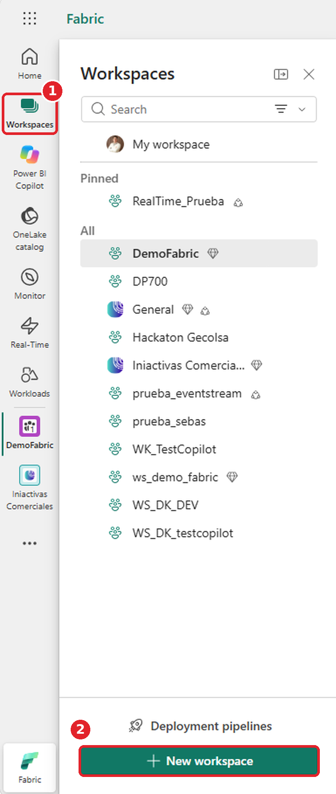
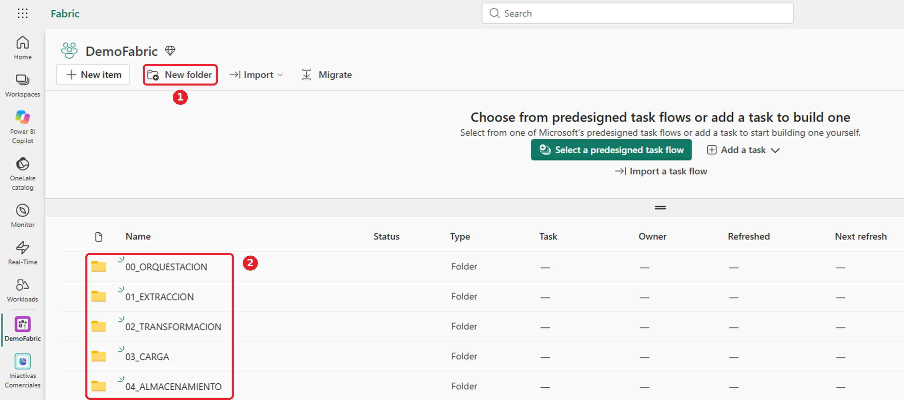
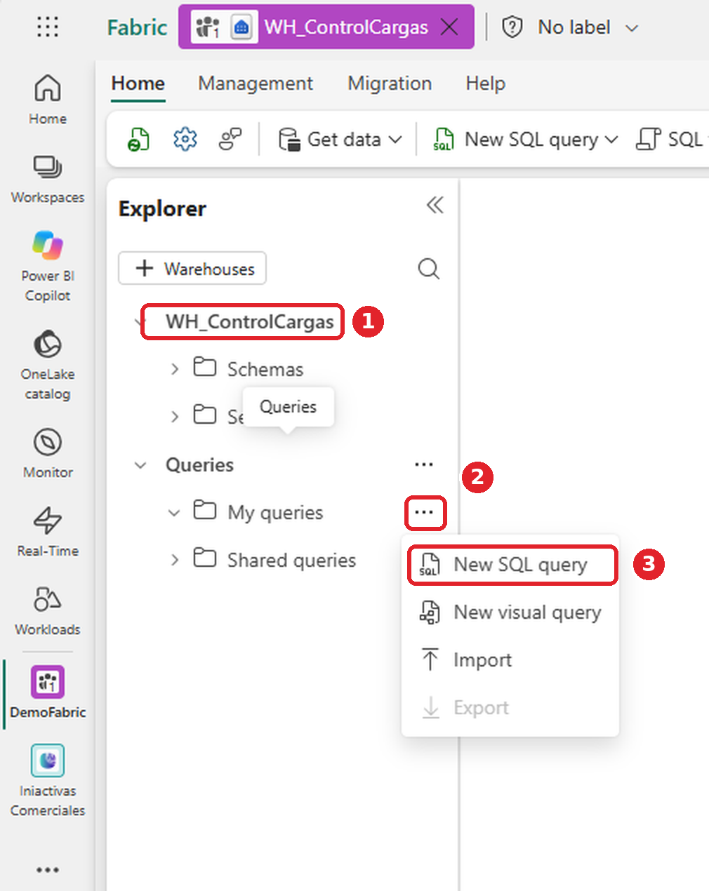
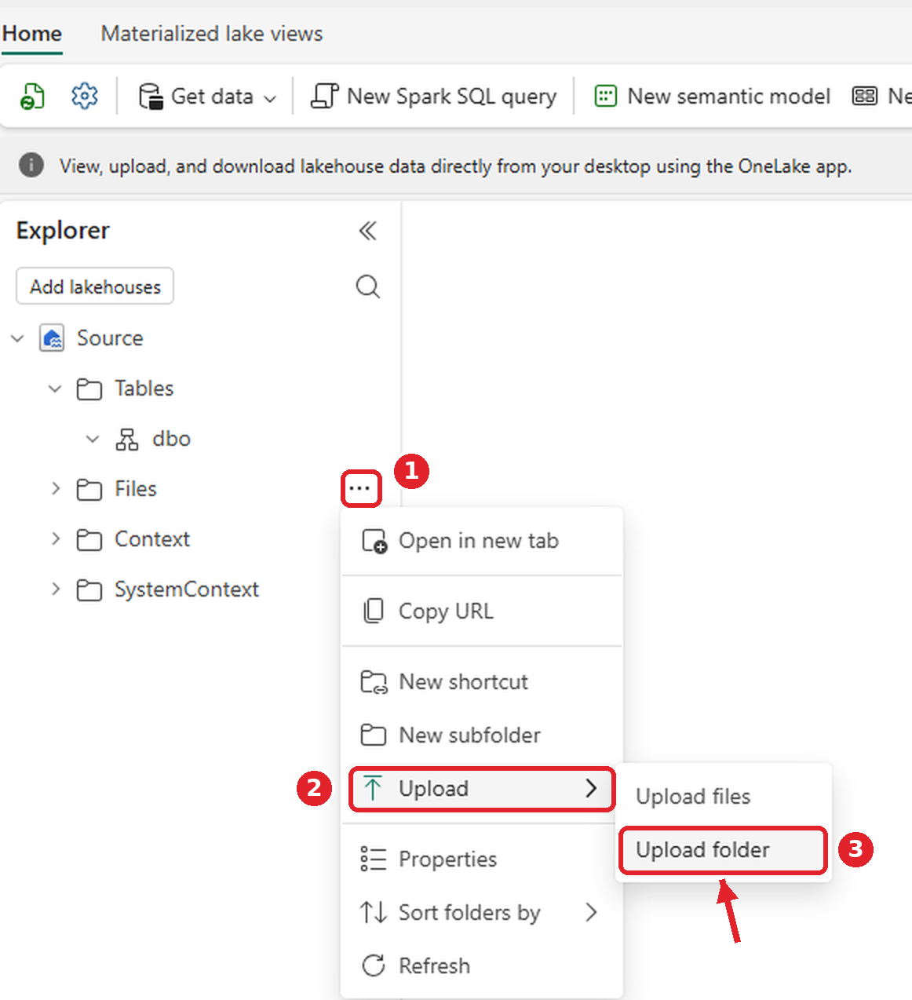

# 🧰 Parte 1 · Preparación del ambiente

En esta parte dejamos listo todo lo que el taller necesita en Microsoft Fabric:

| Paso | Qué haces | Resultado |
|---|---|---|
| [1](#paso-1--crear-el-workspace) | Crear el workspace | Un área de trabajo con capacidad de Fabric |
| [2](#paso-2--organizar-el-workspace-en-carpetas) | Crear las carpetas | El workspace organizado por etapas del flujo |
| [3](#paso-3--crear-los-lakehouses-y-el-warehouse) | Crear los lakehouses y el warehouse | Las capas Bronze, Silver y Gold y el almacén del control de cargas |
| [4](#paso-4--crear-la-tabla-de-control-de-cargas) | Crear la tabla de control de cargas | El framework sabe qué cargar y desde cuándo |
| [5](#paso-5--crear-la-fuente-y-subir-los-archivos) | Crear la fuente y subir los archivos | Los CSV disponibles en una carpeta que simula un SFTP |

> Las capturas tienen **números en rojo** que indican el orden de los clics.

---

## Paso 1 · Crear el workspace

1. En la barra lateral izquierda, haz clic en **Workspaces** ①.
2. En la parte inferior del panel, haz clic en **+ New workspace** ②.

<p align="center"></p>

3. En el panel **Create a workspace**:
   - Escribe el **nombre** del workspace (por ejemplo `DemoFabric`) y, si quieres, una descripción.
   - **Domain:** si tu organización usa dominios, selecciona el que corresponda. Si no, déjalo en blanco.
   - Más abajo, en *Fabric and Power BI workspace types*, selecciona **Fabric** ①.
   - En **Details**, elige la **capacidad** que vas a usar ②.
   - Haz clic en **Apply** ③.

<p align="center"></p>

> **¿Por qué "Fabric" y no "Fabric Trial"?** La prueba gratuita dura 60 días y tiene limitaciones. Para el taller usamos la capacidad asignada.

---

## Paso 2 · Organizar el workspace en carpetas

Las carpetas no cambian cómo funciona Fabric, pero ordenan los elementos según la etapa del flujo de datos. Así cualquiera entiende el workspace de un vistazo.

1. Dentro del workspace, haz clic en **New folder** ①.
2. Crea estas carpetas, una por una ②:

| Carpeta | Qué va a contener |
|---|---|
| `00_ORQUESTACION` | Pipelines que coordinan todo el flujo |
| `01_EXTRACCION` | Lo que mueve los archivos desde la fuente |
| `02_TRANSFORMACION` | Notebooks que limpian y transforman (Bronze → Silver → Gold) |
| `03_CARGA` | Lo que publica los datos para su consumo |
| `04_ALMACENAMIENTO` | Lakehouses y warehouse |
| `05_FUENTE` | El lakehouse que simula el origen de los archivos (SFTP o carpeta local) |

<p align="center"></p>

> La captura muestra las carpetas `00` a `04`. La carpeta `05_FUENTE` se crea igual y la usamos en el paso 5.

---

## Paso 3 · Crear los lakehouses y el warehouse

1. Entra a la carpeta **04_ALMACENAMIENTO**.
2. Haz clic en **+ New item** ①, busca **Lakehouse** y crea tres, uno por capa de la arquitectura medallón ②:
   - `Bronze`
   - `Silver`
   - `Gold`
3. Vuelve a **+ New item**, busca **Warehouse** y crea uno llamado `WH_ControlCargas` ③.

<p align="center"></p>

Cada lakehouse crea automáticamente un **SQL analytics endpoint** con el mismo nombre (las filas que aparecen debajo). Es la vista SQL de solo lectura del lakehouse: no hay que crearla ni configurarla.

> 💬 **Pregunta del día**
> ¿Por qué las capas de la arquitectura medallón se crearon como **lakehouse** y el control de cargas como **warehouse**? ¿Qué diferencias hay entre los dos?

<details>
<summary>Guía para el facilitador (ábrela después de la discusión)</summary>

| | Lakehouse | Warehouse |
|---|---|---|
| Se trabaja con | Spark (notebooks), archivos y tablas | T-SQL |
| Guarda | Archivos de cualquier tipo (`Files`) y tablas Delta (`Tables`) | Solo tablas Delta |
| Escritura con SQL | No: su endpoint SQL es **de solo lectura** | Sí: `INSERT`, `UPDATE`, `DELETE`, transacciones |
| Ideal para | Recibir archivos crudos y transformarlos a escala | Datos estructurados que se consultan y **actualizan** con SQL |

- Las capas Bronze, Silver y Gold reciben archivos (CSV) y se transforman con notebooks: eso es trabajo de **lakehouse**.
- La tabla de control se **actualiza** en cada ejecución (el pipeline mueve el watermark con un `UPDATE`): eso necesita un **warehouse**.
- En los dos casos los datos quedan en **OneLake** en formato **Delta**: es el mismo repositorio, con dos motores distintos.

</details>

---

## Paso 4 · Crear la tabla de control de cargas

La tabla de control le dice al framework **qué archivos cargar, de dónde a dónde, cómo** (completa o incremental) y **desde cuándo** (el watermark).

1. Abre el warehouse **WH_ControlCargas** ①.
2. En el panel **Explorer**, junto a **My queries**, haz clic en **…** ②.
3. Selecciona **New SQL query** ③.

<p align="center"></p>

4. Pega el script [`sql/01_tabla_control_cargas.sql`](../sql/01_tabla_control_cargas.sql) y ejecútalo **en dos partes**:
   - Primero selecciona solo la línea `CREATE SCHEMA ControlCargas;` y haz clic en **Run**.
   - Después selecciona desde `CREATE TABLE` hasta el final del `INSERT` y haz clic en **Run**.
5. Verifica con:
   ```sql
   SELECT * FROM ControlCargas.TablaControlCargas ORDER BY IdCarga;
   ```
   Deben aparecer **5 filas**, una por fuente.

### Qué significa cada campo

| Campo | Para qué sirve | Ejemplo |
|---|---|---|
| `IdCarga` | Identificador del proceso | `3` |
| `NombreProceso` | Nombre del objeto a cargar | `ordenes_mantenimiento` |
| `RutaOrigen` | Carpeta de la fuente, dentro de `Files` del lakehouse `Source` | `fuente/sap/ordenes_mantenimiento` |
| `PatronArchivo` | Archivo exacto, o comodín `*` cuando llega uno por fecha | `ordenes_mantenimiento_*.csv` |
| `Delimitador` | Separador del CSV | `;` |
| `RutaDestino` | Carpeta en `Files` del lakehouse `Bronze` | `bronze/sap/ordenes_mantenimiento` |
| `Esquema` / `Tabla` | Tabla Delta que se crea en Bronze | `SAP` / `ordenes_mantenimiento` |
| `TipoCarga` | `FULL`: se copia y reemplaza todo · `INCREMENTAL`: solo lo nuevo | `INCREMENTAL` |
| `Llave` | Si hay llave, los registros se **actualizan** (MERGE); si no, se **agregan** | `numero_orden` |
| `ColumnaIncremental` | Si un registro llega dos veces, gana el valor más reciente de esta columna | `fecha_modificacion` |
| `FechaUltimaCarga` | **Watermark**: solo se toman archivos modificados después de esta fecha | `1900-01-01` (aún no se ha cargado nada) |
| `Activo` | `1` = se carga · `0` = se omite | `1` |

### Las 5 fuentes configuradas

| IdCarga | Proceso | Tipo de carga | Cómo se comporta |
|---|---|---|---|
| 1 | `pozos` | FULL | Siempre se copia completo |
| 2 | `equipos_bes` | FULL | Siempre se copia completo |
| 3 | `ordenes_mantenimiento` | INCREMENTAL con llave | Solo extracciones nuevas; las órdenes que cambian se actualizan |
| 4 | `pruebas_pozo` | FULL | Siempre se copia completo |
| 5 | `produccion_diaria` | INCREMENTAL sin llave | Solo los archivos de días nuevos; se agregan |

---

## Paso 5 · Crear la fuente y subir los archivos

Este lakehouse hace el papel del **origen externo** (un SFTP o una carpeta local). En un proyecto real los archivos llegarían allí desde el sistema origen; aquí los subimos a mano.

1. Entra a la carpeta **05_FUENTE**, haz clic en **+ New item** → **Lakehouse** y llámalo `Source`.
2. Descarga este repositorio (botón **Code → Download ZIP**) y descomprímelo. Los archivos están en [`datos/fuente`](../datos/fuente).
3. Abre el lakehouse `Source`. En el panel **Explorer**, junto a **Files**, haz clic en **…** ①.
4. Selecciona **Upload** ② → **Upload folder** ③.

<p align="center"></p>

5. Selecciona la carpeta **`fuente`** completa y confirma la carga.
6. Verifica que en `Files` quedó esta estructura:

```
Files/
└── fuente/
    ├── openwell/
    │   ├── pozos.csv
    │   └── pruebas_pozo.csv
    ├── sap/
    │   ├── equipos_bes.csv
    │   └── ordenes_mantenimiento/
    │       └── ordenes_mantenimiento_2026-11-15.csv
    └── produccion/
        ├── produccion_diaria_2026-11-15.csv
        ├── produccion_diaria_2026-11-16.csv
        └── produccion_diaria_2026-11-17.csv
```

Las rutas coinciden con la columna `RutaOrigen` de la tabla de control. Si cambias la estructura, actualiza también la tabla.

> ⏳ **No subas todavía** la carpeta [`datos/llegan_manana`](../datos/llegan_manana). Trae los archivos del **18 de noviembre** (producción y una nueva extracción de órdenes). Los subiremos más adelante, para ver cómo la carga incremental toma **solo lo nuevo**.

### Qué contienen los archivos

Son datos **sintéticos** de pozos de tres campos ficticios (Morichal, Garcero y Samán). Están separados por `;` y traen errores **a propósito**, que limpiaremos en la capa Silver.

| Archivo | Simula | Errores que trae |
|---|---|---|
| `openwell/pozos.csv` | Maestro de pozos (OpenWell) | Pozos duplicados, nombres de campo con variantes, coordenadas invertidas o vacías, fechas en dos formatos |
| `openwell/pruebas_pozo.csv` | Pruebas de pozo | Pozo escrito de varias formas, BSW mayor a 100 %, pruebas sin aceite o con duración 0 |
| `sap/equipos_bes.csv` | Equipos de bombeo (export de SAP) | Encabezados con espacios, fabricante con variantes, equipos en pozos que no existen |
| `sap/ordenes_mantenimiento/…` | Órdenes de mantenimiento (SAP PM) | Costos como `$ 12.500.000`, estados con variantes, órdenes repetidas |
| `produccion/produccion_diaria_….csv` | Reporte diario, un archivo por día | Coma decimal, valores negativos, más de 24 horas, el 16 faltan pozos de Samán |

---

✅ **Al terminar esta parte tienes:** el workspace organizado, las capas Bronze, Silver y Gold, la tabla de control de cargas con las 5 fuentes, y los archivos esperando en la fuente.

⬅️ [Volver al inicio](../README.md)
