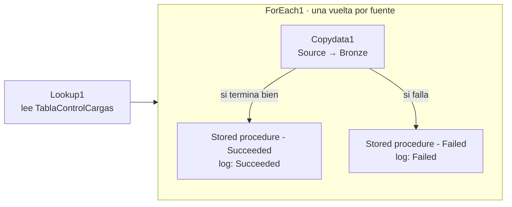
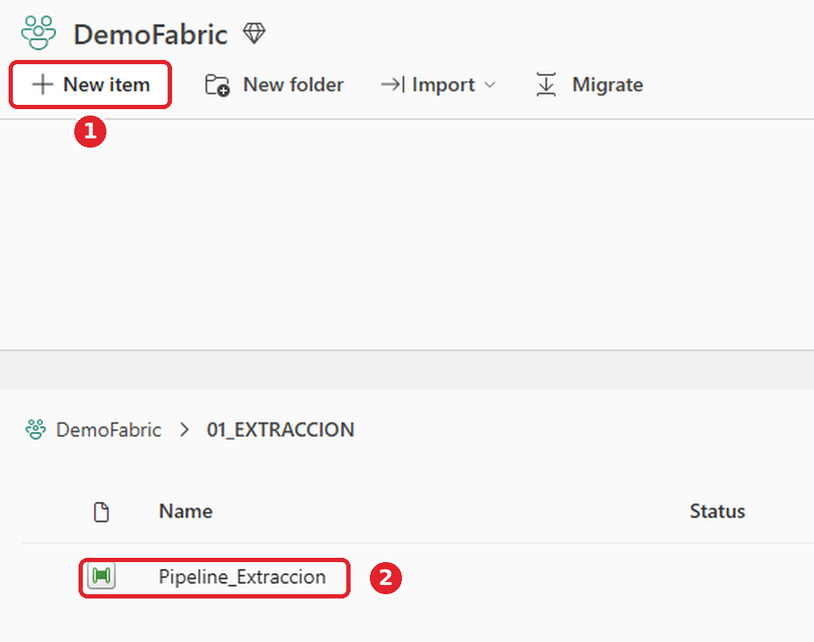
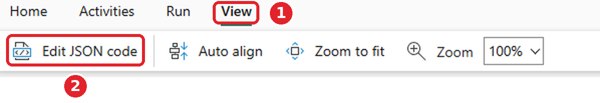

# 🚚 Parte 2 · Extracción: de la fuente a Bronze

En esta parte creamos el pipeline que **lee la tabla de control** y, para cada fuente, **copia el archivo** desde el lakehouse `Source` (el SFTP simulado) a la carpeta de `Bronze`, y **deja registro** en el log de auditoría.



| Paso | Qué haces | Resultado |
|---|---|---|
| [1](#paso-1--crear-el-pipeline) | Crear el pipeline | `Pipeline_Extraccion` en la carpeta `01_EXTRACCION` |
| [2](#paso-2--pegar-el-código-json) | Pegar el código JSON | Las actividades del pipeline creadas de una vez |
| [3](#paso-3--revisar-las-conexiones) | Revisar las conexiones | Cada actividad apunta a tu warehouse y a tus lakehouses |
| [4](#paso-4--ejecutar-y-validar) | Ejecutar y validar | 5 archivos en Bronze y 5 filas en el log |

---

## Paso 1 · Crear el pipeline

1. Entra a la carpeta **01_EXTRACCION**.
2. Haz clic en **+ New item** ①, busca **Pipeline** (en algunas versiones aparece como *Data pipeline*) y llámalo `Pipeline_Extraccion` ②.

<p align="center"></p>

---

## Paso 2 · Pegar el código JSON

En lugar de arrastrar y configurar cada actividad a mano, pegamos la definición completa del pipeline.

1. Abre `Pipeline_Extraccion`.
2. Ve a la pestaña **View** ① y haz clic en **Edit JSON code** ②.

<p align="center"></p>

3. **Borra todo** el contenido del editor y pega el archivo [`pipeline/Pipeline_Extraccion.json`](../pipeline/Pipeline_Extraccion.json).
4. Haz clic en **OK**. El lienzo muestra las actividades `Lookup1` y `ForEach1`; dentro del `ForEach1` están `Copydata1` y los dos procedimientos almacenados.

---

## Paso 3 · Revisar las conexiones

El JSON trae **marcadores** (`<ID_WORKSPACE>`, `<ID_LAKEHOUSE_SOURCE>`, `<ID_LAKEHOUSE_BRONZE>`, `<ID_WH_CONTROLCARGAS>`…) en lugar de los identificadores de un workspace real. Por eso, después de pegarlo, cada actividad debe **apuntar de nuevo a tus elementos**:

| Actividad | Pestaña | Qué seleccionar |
|---|---|---|
| `Lookup1` | **Settings** | Conexión: **WH_ControlCargas** · Tabla: `ControlCargas.TablaControlCargas` · **First row only** desmarcado |
| `Copydata1` | **Source** | Conexión: lakehouse **Source** · Carpeta raíz: **Files** |
| `Copydata1` | **Destination** | Conexión: lakehouse **Bronze** · Carpeta raíz: **Files** |
| `Stored procedure - Succeeded` | **Settings** | Conexión: **WH_ControlCargas** · Procedimiento: `[ControlCargas].[PostLogAuditoriaControlCargas]` |
| `Stored procedure - Failed` | **Settings** | Conexión: **WH_ControlCargas** · Procedimiento: `[ControlCargas].[PostLogAuditoriaControlCargas]` |

Al cambiar la conexión, revisa que **no se hayan borrado** los valores dinámicos. Deben quedar así:

| Actividad | Campo | Valor |
|---|---|---|
| `Copydata1` · Source | Carpeta | `@item().RutaOrigen` |
| `Copydata1` · Source | Archivo | `@item().NombreArchivo` |
| `Copydata1` · Source | Delimitador de columnas | `@item().Delimitador` |
| `Copydata1` · Destination | Carpeta | `@item().RutaDestino` |
| `Copydata1` · Destination | Archivo | `@item().NombreArchivo` |
| `Copydata1` · Destination | Delimitador de columnas | `@item().Delimitador` |

Si al cambiar el procedimiento desaparecen los parámetros, haz clic en **Import** dentro de *Stored procedure parameters* y vuelve a escribir los valores de la tabla del final de esta página.

---

## Paso 4 · Ejecutar y validar

1. Haz clic en **Save** y luego en **Run**.
2. En el panel **Output** debe aparecer `Lookup1` en verde y el `ForEach1` con **5 vueltas**, una por fuente.
3. Abre el lakehouse **Bronze** → **Files**. Debe quedar esta estructura:

```
Files/
└── bronze/
    ├── openwell/
    │   ├── pozos.csv
    │   └── pruebas_pozo.csv
    ├── sap/
    │   ├── equipos_bes.csv
    │   └── ordenes_mantenimiento.csv
    └── produccion/
        └── produccion_diaria.csv
```

4. En **WH_ControlCargas**, abre una **New SQL query** y revisa el log:

```sql
SELECT  c.NombreProceso,
        l.EstadoEjecucion,
        l.TiempoCopiadoSegundos,
        l.FechaInicio
FROM    ControlCargas.TablaLogAuditoria AS l
JOIN    ControlCargas.TablaControlCargas AS c ON c.IdCarga = l.IdCarga
ORDER BY l.FechaInicio DESC;
```

Deben aparecer **5 filas** con estado `Succeeded`.

---

## Cómo funciona el pipeline

| Actividad | Qué hace | Cómo lo hace |
|---|---|---|
| `Lookup1` | Lee la tabla de control | Devuelve las filas de `ControlCargas.TablaControlCargas` como una lista |
| `ForEach1` | Recorre esa lista | `@activity('Lookup1').output.value` · **secuencial**: una fuente a la vez |
| `Copydata1` | Copia el archivo de la fuente a Bronze | Lee cada valor de la fila actual con `@item()`: `RutaOrigen`, `NombreArchivo`, `Delimitador`, `RutaDestino` |
| `Stored procedure - Succeeded` | Registra la copia exitosa | Se ejecuta **solo si** `Copydata1` termina bien |
| `Stored procedure - Failed` | Registra la copia fallida | Se ejecuta **solo si** `Copydata1` falla |

Parámetros que reciben los procedimientos:

| Parámetro | Succeeded | Failed |
|---|---|---|
| `IdCarga` | `@item().IdCarga` | `@item().IdCarga` |
| `TipoFuente` | `@item().NombreProceso` | `@item().NombreProceso` |
| `NombreFuente` | `@concat(item().Esquema, '.', item().Tabla)` | igual |
| `EstadoEjecucion` | `Succeeded` | `Failed` |
| `TiempoCopiadoSegundos` | `@activity('Copydata1').output.executionDetails[0].duration` | `0` |
| `FechaInicio` | `@formatDateTime(addHours(utcNow(), -5), 'yyyy-MM-dd''T''HH:mm:ss')` | igual |

> **¿Por qué el procedimiento de fallo no lee el resultado de la copia?** Cuando la copia falla, muchas veces no existe `executionDetails`. Si el procedimiento intentara leerlo, también fallaría y el error no quedaría en el log. Por eso usa valores fijos.

> **Sobre `FechaInicio`:** se calcula cuando corre el procedimiento, es decir, al terminar la copia, en hora de Colombia (UTC−5).

---

## 🧪 Prueba: ¿qué pasa si un archivo no existe?

1. En **WH_ControlCargas**, cambia el nombre de un archivo en la tabla de control:
   ```sql
   UPDATE ControlCargas.TablaControlCargas SET NombreArchivo = 'pozos_x.csv' WHERE IdCarga = 1;
   ```
2. Ejecuta el pipeline de nuevo.
3. Revisa el log: la fuente `pozos` aparece con `Failed` y `0` segundos, y las otras cuatro con `Succeeded`.
4. Deja el nombre como estaba:
   ```sql
   UPDATE ControlCargas.TablaControlCargas SET NombreArchivo = 'pozos.csv' WHERE IdCarga = 1;
   ```

> ⚠️ **Ojo con el monitor:** cuando la copia falla pero el procedimiento de fallo se ejecuta bien, el pipeline puede aparecer como **exitoso**, porque el error quedó "atendido". El fallo real se ve en la tabla `TablaLogAuditoria`. Por eso el log es la fuente de verdad del framework.

## 💡 Para ir más allá: usar la columna `Activo`

Hoy `Lookup1` lee **toda** la tabla de control, así que la columna `Activo` no apaga ninguna fuente. Para que sí lo haga, en `Lookup1` → **Settings** cambia *Use* de **Table** a **Query** y escribe:

```sql
SELECT * FROM ControlCargas.TablaControlCargas WHERE Activo = 1 ORDER BY IdCarga;
```

---

✅ **Al terminar esta parte tienes:** un pipeline dirigido por la tabla de control que copia las 5 fuentes a Bronze y registra cada copia en el log de auditoría.

➡️ [Parte 3 · Transformación](../03-Transformacion/README.md) · ⬅️ [Parte 1 · Preparación del ambiente](../01-Preparacion-del-ambiente/README.md) · [Volver al inicio](../README.md)
