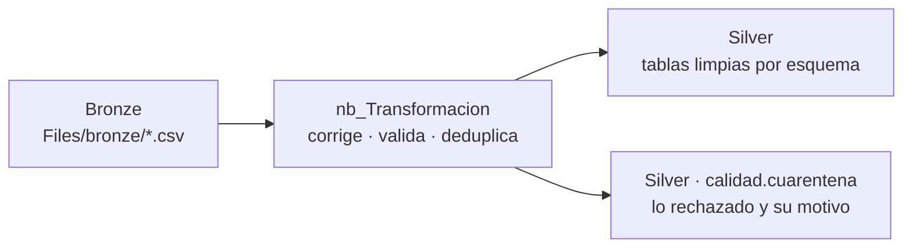
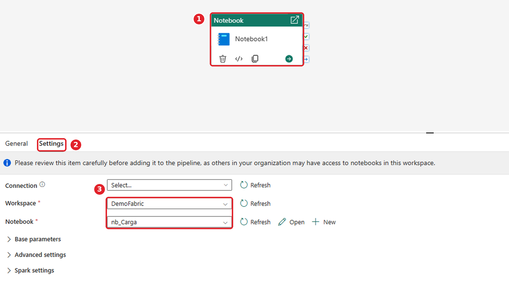

# 🧹 Parte 3 · Transformación: de Bronze a Silver

En esta parte creamos el notebook que **valida y limpia** los archivos que el pipeline dejó en Bronze, y lo dejamos dentro de un pipeline que **avisa por correo** si algo falla.

| Paso | Qué haces | Resultado |
|---|---|---|
| [1](#paso-1--crear-el-notebook) | Crear el notebook | `nb_Transformacion` en la carpeta `02_TRANSFORMACION` |
| [2](#paso-2--agregar-el-código) | Agregar el código | El notebook con las reglas de limpieza y validación |
| [3](#paso-3--ejecutar-y-revisar-el-resultado) | Ejecutar y revisar | Tablas limpias en Silver y la cuarentena con lo rechazado |
| [4](#paso-4--crear-el-pipeline-con-aviso-por-correo) | Crear el pipeline con aviso por correo | `Pipeline_Transformacion`, que ejecuta el notebook y envía un correo si falla |

---

## Paso 1 · Crear el notebook

1. Entra a la carpeta **02_TRANSFORMACION**.
2. Haz clic en **+ New item** ①, busca **Notebook** y llámalo `nb_Transformacion` ②.

3. Abre el notebook. En el panel **Explorer**, haz clic en **Add data items** → **Existing data sources** y selecciona el lakehouse **Silver**. Queda como **lakehouse predeterminado**: ahí se escriben las tablas.

> El notebook **lee** de Bronze por su ruta de OneLake, así que no hace falta agregar Bronze al notebook.

---

## Paso 2 · Agregar el código

Elige una de las dos opciones:

- **Opción A · Pegar el código.** Copia todo el contenido de [`notebooks/nb_Transformacion.py`](../notebooks/nb_Transformacion.py) y pégalo en la primera celda del notebook.
- **Opción B · Importar el notebook ya armado (con sus celdas).** En la carpeta `02_TRANSFORMACION`, haz clic en **Import → Notebook → From this computer** y selecciona [`notebooks/nb_Transformacion.ipynb`](../notebooks/nb_Transformacion.ipynb). Después agrega el lakehouse **Silver** como en el paso 1.

**Parámetros** (al inicio del código):

| Parámetro | Valor por defecto | Cuándo cambiarlo |
|---|---|---|
| `WORKSPACE` | vacío: usa el workspace donde corre el notebook | Si da error leyendo el nombre, escríbelo (sin espacios, por ejemplo `DemoFabric`) |
| `LH_BRONZE` | `Bronze` | Si tu lakehouse de Bronze se llama distinto |

### Qué hace el código

El notebook tiene 3 celdas de código (más la de parámetros):

| Celda | Qué hace |
|---|---|
| Funciones | Limpiezas reutilizables: números con coma decimal (`num`), fechas en tres formatos (`fecha`), la llave del pozo (`pozo`) y valores con variantes (`homologar`, por ejemplo `TECO` / `CERRADO` → `Cerrada`). La función `procesar` hace el trabajo de cada fuente: lee el CSV, limpia, aplica las reglas, quita duplicados y escribe en Silver |
| Fuentes | Una llamada a `procesar` por fuente, con sus columnas y sus reglas escritas como condiciones SQL (por ejemplo `"VOLUMEN_NEGATIVO": "aceite_bbl < 0 OR agua_bbl < 0"`) |
| Cuarentena | Guarda todo lo rechazado en `calidad.cuarentena` y muestra cuántos registros rechazó cada motivo |

Cada fuente se limpia en dos pasos:

1. **Corrección:** el dato se arregla y sigue. Por ejemplo `"245,5"` → `245.5` o `"MORICHAL 1"` → `MOR-001`.
2. **Rechazo:** si el registro cumple una regla de rechazo, o está repetido, no pasa a Silver y va a la cuarentena con el **motivo**.

| Tabla | Motivos de rechazo |
|---|---|
| `openwell.pozos` | `POZO_INVALIDO`, `FUERA_DE_COLOMBIA`, `DUPLICADO` (gana la actualización más reciente) |
| `sap.equipos_bes` | `POZO_NO_EXISTE`, `FECHA_FUTURA` |
| `sap.ordenes_mantenimiento` | `EQUIPO_NO_EXISTE`, `FIN_ANTES_DEL_INICIO`, `DUPLICADO` (gana la última modificación) |
| `openwell.pruebas_pozo` | `POZO_NO_EXISTE`, `SIN_ACEITE`, `DURACION_INVALIDA`, `FECHA_FUTURA` |
| `produccion.produccion_diaria` | `POZO_NO_EXISTE`, `FECHA_INVALIDA`, `VOLUMEN_NEGATIVO`, `HORAS_FUERA_DE_RANGO`, `DUPLICADO` (gana la última fila del archivo) |

> **Homologación de pozos:** el mismo pozo llega escrito de varias formas según la fuente (`CO-LLA-MOR-0001`, `CO-LLA-MORICHAL-001`, `MORICHAL 1`, ` mor-1 `). El notebook construye una sola llave, `clave_pozo` = `MOR-001`, que es la que une las fuentes.

---

## Paso 3 · Ejecutar y revisar el resultado

1. Haz clic en **Run all**. La primera ejecución tarda un poco más porque arranca la sesión de Spark.
2. Por cada fuente se imprime cuántas filas se leyeron y cuántas pasaron a Silver. Con los datos del taller:

| Tabla en Silver | Filas leídas | Filas en Silver | A cuarentena |
|---|---|---|---|
| `openwell.pozos` | 34 | 30 | 4 |
| `sap.equipos_bes` | 61 | 59 | 2 |
| `sap.ordenes_mantenimiento` | 155 | 137 | 18 |
| `openwell.pruebas_pozo` | 187 | 182 | 5 |
| `produccion.produccion_diaria` | 113 | 99 | 14 |

3. En el lakehouse **Silver**, en **Tables**, deben aparecer los esquemas `openwell`, `sap`, `produccion` y `calidad`.
4. La última celda muestra cuántos registros rechazó cada motivo. El detalle está en `calidad.cuarentena`: cada fila trae la tabla, el motivo y el registro completo en JSON.

> 💬 **Para conversar:** 13 de las 18 órdenes rechazadas son versiones viejas de órdenes que se actualizaron, y 2 se rechazan "en cascada" porque su equipo fue rechazado por tener una fecha de instalación futura. ¿Quién debería decidir qué pasa con lo que queda en cuarentena: TI o el dueño del dato?

> El notebook escribe en **esquemas** (`openwell.pozos`), así que el lakehouse Silver debe tener los esquemas habilitados: en *Tables* aparece `dbo`. Los lakehouses nuevos los traen habilitados.

---

## Paso 4 · Crear el pipeline con aviso por correo

1. En la carpeta **02_TRANSFORMACION**, crea un **Pipeline** llamado `Pipeline_Transformacion`.
2. Agrega una actividad **Notebook** ①. En la pestaña **Settings** ②, selecciona el **Workspace** y el notebook **`nb_Transformacion`** ③.

> La captura muestra `nb_Carga` porque es la misma configuración que usaremos en la parte 4. Aquí selecciona **`nb_Transformacion`**.

3. Agrega una actividad **Office 365 Outlook** (*Office 365 Email*) ②.
4. Conecta la salida **en rojo (✕, "On fail")** del notebook ① con la actividad de correo. Así el correo **solo se envía si el notebook falla**.
5. En la pestaña **Settings** del correo ③ ④:
   - **Connection:** inicia sesión con tu cuenta de Outlook (la primera vez crea la conexión).
   - **To:** el correo de quien debe enterarse del fallo.
   - **Subject** y **Body:** puedes escribir un texto fijo o usar contenido dinámico (ícono ⚡), por ejemplo:

| Campo | Contenido dinámico sugerido |
|---|---|
| Subject | `@concat('Falló ', pipeline().Pipeline)` |
| Body | `@concat('El notebook nb_Transformacion falló. Ejecución: ', pipeline().RunId, '. Error: ', activity('Notebook1').error.message)` |

6. Haz clic en **Save** y luego en **Run**. Si el notebook termina bien, el correo **no** se envía.

> 🧪 **Para probar el correo:** cambia el parámetro `LH_BRONZE` del notebook por un nombre que no exista (por ejemplo `BronzeX`), ejecuta el pipeline y revisa tu bandeja. Después déjalo como estaba.

---

✅ **Al terminar esta parte tienes:** las 5 fuentes limpias y homologadas en Silver, la cuarentena con todo lo rechazado y su motivo, y un pipeline que avisa por correo si la transformación falla.

➡️ [Parte 4 · Carga](../04-Carga/README.md) · ⬅️ [Parte 2 · Extracción](../02-Extraccion/README.md) · [Volver al inicio](../README.md)
