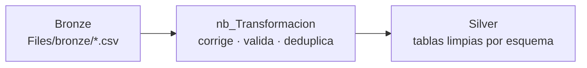
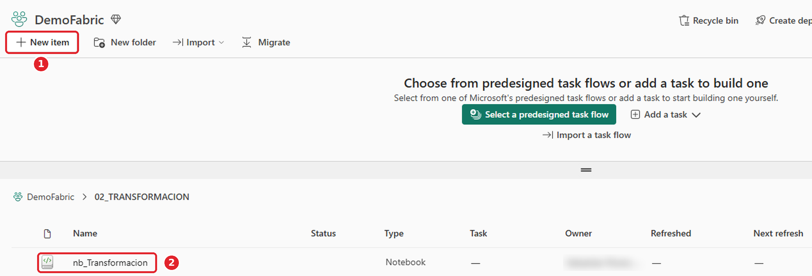

# 🧹 Parte 3 · Transformación: de Bronze a Silver

En esta parte creamos el notebook que **limpia** los archivos que el pipeline dejó en Bronze y los guarda como tablas en Silver, y lo dejamos dentro de un pipeline que **avisa por correo** si algo falla.

| Paso | Qué haces | Resultado |
|---|---|---|
| [1](#paso-1--crear-el-notebook) | Crear el notebook | `nb_Transformacion` en la carpeta `02_TRANSFORMACION` |
| [2](#paso-2--agregar-el-código) | Agregar el código | El notebook con las reglas de limpieza |
| [3](#paso-3--ejecutar-y-revisar-el-resultado) | Ejecutar y revisar | 5 tablas limpias en Silver |
| [4](#paso-4--crear-el-pipeline-con-aviso-por-correo) | Crear el pipeline con aviso por correo | `Pipeline_Transformacion`, que ejecuta el notebook y envía un correo si falla |

---

## Paso 1 · Crear el notebook

1. Entra a la carpeta **02_TRANSFORMACION**.
2. Haz clic en **+ New item** ①, busca **Notebook** y llámalo `nb_Transformacion` ②.

3. Abre el notebook. En el panel **Explorer**, haz clic en **Add data items** → **Existing data sources** y selecciona el lakehouse **Silver**. Queda como **lakehouse predeterminado**: ahí se escriben las tablas.

> El notebook **lee** de Bronze por su ruta de OneLake, así que no hace falta agregar Bronze al notebook.

---

## Paso 2 · Agregar el código

Elige una de las dos opciones:

- **Opción A · Pegar el código.** Copia todo el contenido de [`notebooks/nb_Transformacion.py`](../notebooks/nb_Transformacion.py) y pégalo en la primera celda del notebook.
- **Opción B · Importar el notebook ya armado (con sus celdas).** En la carpeta `02_TRANSFORMACION`, haz clic en **Import → Notebook → From this computer** y selecciona [`notebooks/nb_Transformacion.ipynb`](../notebooks/nb_Transformacion.ipynb). Después agrega el lakehouse **Silver** como en el paso 1.

**Parámetros** (al inicio del código):

| Parámetro | Valor por defecto | Cuándo cambiarlo |
|---|---|---|
| `WORKSPACE` | vacío: usa el workspace donde corre el notebook | Si da error leyendo el nombre, escríbelo (sin espacios, por ejemplo `DemoFabric`) |
| `LH_BRONZE` | `Bronze` | Si tu lakehouse de Bronze se llama distinto |

### Qué hace el código

El notebook tiene una sección por fuente, y cada una sigue los mismos tres pasos:

| Paso | Qué pasa con el dato |
|---|---|
| **Limpiar** | Se corrige el formato: números con coma decimal, fechas en varios formatos, nombres con variantes |
| **Filtrar** | Se descartan los registros que no sirven |
| **Quitar duplicados** | Si un registro llega más de una vez, se conserva el más reciente |

| Sección | Limpieza | Filtro |
|---|---|---|
| 2. Pozos | Llave del pozo, campo en mayúsculas, coordenadas invertidas, fechas | Identificador válido · sin duplicados (gana la actualización más reciente) |
| 3. Equipos BES | Ubicación técnica SAP → llave del pozo, fabricante homologado | Solo equipos de pozos que existen |
| 4. Órdenes | Estados (`TECO`, `Cerrada`, `CERRADO` → `Cerrada`), tipo de orden, costo, fechas | Sin duplicados (gana la última modificación) |
| 5. Pruebas de pozo | Llave del pozo, números, BSW recalculado | Solo pruebas con aceite medido |
| 6. Producción diaria | Llave del pozo, coma decimal, BSW | Pozos que existen y con fecha · sin volúmenes negativos · sin duplicados |

La sección 1 define las funciones que usan todas las fuentes, y la 7 muestra un resumen de cuántas filas quedaron.

> **Homologación de pozos:** el mismo pozo llega escrito de varias formas según la fuente (`CO-LLA-MOR-0001`, `CO-LLA-MORICHAL-001`, `MORICHAL 1`, ` mor-1 `). La función `clave_pozo` construye una sola llave, `MOR-001`, que es la que une las fuentes.

---

## Paso 3 · Ejecutar y revisar el resultado

1. Haz clic en **Run all**. La primera ejecución tarda un poco más porque arranca la sesión de Spark.
2. Cada sección muestra una vista previa del resultado y la última celda, el resumen. Con los datos del taller:

| Tabla en Silver | Filas en Bronze | Filas en Silver | Descartadas |
|---|---|---|---|
| `openwell.pozos` | 34 | 31 | 3 |
| `sap.equipos_bes` | 61 | 60 | 1 |
| `sap.ordenes_mantenimiento` | 155 | 142 | 13 |
| `openwell.pruebas_pozo` | 187 | 185 | 2 |
| `produccion.produccion_diaria` | 113 | 101 | 12 |

3. En el lakehouse **Silver**, en **Tables**, deben aparecer los esquemas `openwell`, `sap` y `produccion`.

> 💬 **Para conversar:** las 13 órdenes descartadas son versiones viejas de órdenes que se actualizaron después. ¿Qué otros datos de Sierracol llegan "repetidos" y cómo se decide cuál es el bueno?

> El notebook escribe en **esquemas** (`openwell.pozos`), así que el lakehouse Silver debe tener los esquemas habilitados: en *Tables* aparece `dbo`. Los lakehouses nuevos los traen habilitados.

---

## Paso 4 · Crear el pipeline con aviso por correo

1. En la carpeta **02_TRANSFORMACION**, crea un **Pipeline** llamado `Pipeline_Transformacion`.
2. Agrega una actividad **Notebook** ①. En la pestaña **Settings** ②, selecciona el **Workspace** y el notebook **`nb_Transformacion`** ③.

> La captura muestra `nb_Carga` porque es la misma configuración que usaremos en la parte 4. Aquí selecciona **`nb_Transformacion`**.

3. Agrega una actividad **Office 365 Outlook** (*Office 365 Email*) ②.
4. Conecta la salida **en rojo (✕, "On fail")** del notebook ① con la actividad de correo. Así el correo **solo se envía si el notebook falla**.
5. En la pestaña **Settings** del correo ③ ④:
   - **Connection:** inicia sesión con tu cuenta de Outlook (la primera vez crea la conexión).
   - **To:** el correo de quien debe enterarse del fallo.
   - **Subject** y **Body:** puedes escribir un texto fijo o usar contenido dinámico (ícono ⚡), por ejemplo:

| Campo | Contenido dinámico sugerido |
|---|---|
| Subject | `@concat('Falló ', pipeline().Pipeline)` |
| Body | `@concat('El notebook nb_Transformacion falló. Ejecución: ', pipeline().RunId, '. Error: ', activity('Notebook1').error.message)` |

6. Haz clic en **Save** y luego en **Run**. Si el notebook termina bien, el correo **no** se envía.

> 🧪 **Para probar el correo:** cambia el parámetro `LH_BRONZE` del notebook por un nombre que no exista (por ejemplo `BronzeX`), ejecuta el pipeline y revisa tu bandeja. Después déjalo como estaba.

---

✅ **Al terminar esta parte tienes:** las 5 fuentes limpias y homologadas en Silver, y un pipeline que avisa por correo si la transformación falla.

➡️ [Parte 4 · Carga](../04-Carga/README.md) · ⬅️ [Parte 2 · Extracción](../02-Extraccion/README.md) · [Volver al inicio](../README.md)
