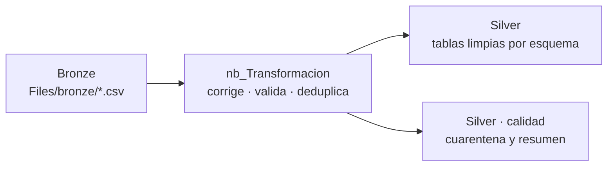
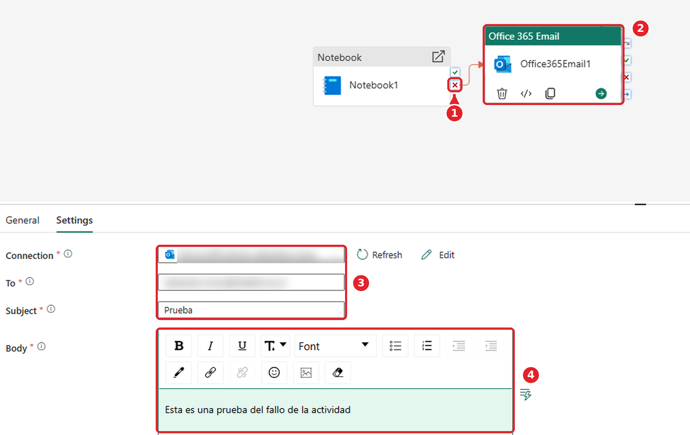

# 🧹 Parte 3 · Transformación: de Bronze a Silver

En esta parte creamos el notebook que **valida y limpia** los archivos que el pipeline dejó en Bronze, y lo dejamos dentro de un pipeline que **avisa por correo** si algo falla.

| Paso | Qué haces | Resultado |
|---|---|---|
| [1](#paso-1--crear-el-notebook) | Crear el notebook | `nb_Transformacion` en la carpeta `02_TRANSFORMACION` |
| [2](#paso-2--agregar-el-código) | Agregar el código | El notebook con las reglas de calidad |
| [3](#paso-3--ejecutar-y-revisar-el-resultado) | Ejecutar y revisar | Tablas limpias en Silver y la cuarentena con lo rechazado |
| [4](#paso-4--crear-el-pipeline-con-aviso-por-correo) | Crear el pipeline con aviso por correo | `Pipeline_Transformacion`, que ejecuta el notebook y envía un correo si falla |

---

## Paso 1 · Crear el notebook

1. Entra a la carpeta **02_TRANSFORMACION**.
2. Haz clic en **+ New item** ①, busca **Notebook** y llámalo `nb_Transformacion` ②.

3. Abre el notebook. En el panel **Explorer**, haz clic en **Add data items** → **Existing data sources** y selecciona el lakehouse **Silver**. Queda como **lakehouse predeterminado**: ahí se escriben las tablas.

> El notebook **lee** de Bronze por su ruta de OneLake, así que no hace falta agregar Bronze al notebook.

---

## Paso 2 · Agregar el código

Elige una de las dos opciones:

- **Opción A · Pegar el código.** Copia todo el contenido de [`notebooks/nb_Transformacion.py`](../notebooks/nb_Transformacion.py) y pégalo en la primera celda del notebook.
- **Opción B · Importar el notebook ya armado (con celdas y explicaciones).** En la carpeta `02_TRANSFORMACION`, haz clic en **Import → Notebook → From this computer** y selecciona [`notebooks/nb_Transformacion.ipynb`](../notebooks/nb_Transformacion.ipynb). Después agrega el lakehouse **Silver** como en el paso 1.

**Parámetros** (al inicio del código):

| Parámetro | Valor por defecto | Cuándo cambiarlo |
|---|---|---|
| `WORKSPACE` | vacío: usa el workspace donde corre el notebook | Si da error leyendo el nombre, escríbelo (sin espacios, por ejemplo `DemoFabric`) |
| `LH_BRONZE` | `Bronze` | Si tu lakehouse de Bronze se llama distinto |

### Qué hace el código

1. **Lee** cada CSV de `Files/bronze/...` **como texto** y normaliza los encabezados (`"ID EQUIPO"` → `id_equipo`).
2. Aplica cuatro tipos de regla por fuente:

| Tipo | Qué hace | Ejemplo |
|---|---|---|
| **Corrección** | Arregla el dato y sigue | `"245,5"` → `245.5` · `"MORICHAL 1"` → `MOR-001` |
| **Rechazo** | El registro no pasa a Silver: va a la **cuarentena** con el motivo | Aceite negativo |
| **Advertencia** | El registro pasa, pero queda marcado en la columna `advertencias` | Pozo sin coordenadas |
| **Duplicado** | Si un registro llega más de una vez, se conserva uno | La misma orden en dos versiones |

3. **Escribe** las tablas limpias en Silver, una por fuente, y las tablas de calidad.

Ver todas las reglas

| Fuente | Regla | Tipo | Qué atiende |
|---|---|---|---|
| pozos | POZ-C1 | Corrección | Campo escrito con variantes (`Morichal`, `MORICHAL `, `morichal`) |
| pozos | POZ-C2 | Corrección | Latitud y longitud invertidas |
| pozos | POZ-C3 | Corrección | Fechas en dos formatos y profundidad con texto (`8828 ft`) |
| pozos | POZ-01 | Rechazo | Identificador de pozo inválido (`POZO-PRUEBA`) |
| pozos | POZ-02 | Rechazo | Coordenadas fuera de Colombia (`0,0`) |
| pozos | POZ-03 | Advertencia | Coordenadas vacías |
| pozos | POZ-04 | Advertencia | Coordenadas que venían invertidas |
| pozos | POZ-05 | Advertencia | Método de levantamiento sin dato |
| pozos | POZ-DUP | Rechazo | El mismo pozo dos veces: gana la actualización más reciente |
| equipos_bes | EQU-C1 | Corrección | Fabricante con variantes (`FABRICANTE A`, `Fab. A`) |
| equipos_bes | EQU-C2 | Corrección | Ubicación técnica SAP → `clave_pozo`; potencia 0 → vacía |
| equipos_bes | EQU-01 | Rechazo | El pozo no existe en el maestro |
| equipos_bes | EQU-02 | Rechazo | Fecha de instalación futura o inválida |
| equipos_bes | EQU-03 | Advertencia | Potencia sin dato |
| ordenes_mantenimiento | ORD-C1 | Corrección | Estados `TECO` / `Cerrada` / `CERRADO` → Creada / Liberada / Cerrada |
| ordenes_mantenimiento | ORD-C2 | Corrección | Costo como `$ 12.500.000` o `12.500.000,00` |
| ordenes_mantenimiento | ORD-01 | Rechazo | El equipo no existe o fue rechazado en Silver |
| ordenes_mantenimiento | ORD-02 | Rechazo | Fecha de fin anterior a la de inicio |
| ordenes_mantenimiento | ORD-03 | Rechazo | Estado no reconocido |
| ordenes_mantenimiento | ORD-04 | Advertencia | Orden cerrada sin costo |
| ordenes_mantenimiento | ORD-DUP | Rechazo | La misma orden en dos versiones: gana la última modificación |
| pruebas_pozo | PRU-C1 | Corrección | Pozo con variantes; el BSW se recalcula con agua / (agua + aceite) |
| pruebas_pozo | PRU-01 | Rechazo | El pozo no existe |
| pruebas_pozo | PRU-02 | Rechazo | Prueba sin aceite medido |
| pruebas_pozo | PRU-03 | Rechazo | Duración 0 o vacía |
| pruebas_pozo | PRU-04 | Rechazo | Fecha de prueba futura |
| pruebas_pozo | PRU-05 | Advertencia | BSW reportado distinto al calculado |
| produccion_diaria | PRO-C1 | Corrección | Pozo con variantes y coma decimal |
| produccion_diaria | PRO-01 | Rechazo | El pozo no existe (`MOR-099`) |
| produccion_diaria | PRO-02 | Rechazo | Volumen negativo |
| produccion_diaria | PRO-03 | Rechazo | Horas de operación fuera de 0–24 |
| produccion_diaria | PRO-04 | Rechazo | Fecha inválida o vacía |
| produccion_diaria | PRO-DUP | Rechazo | Mismo pozo y fecha más de una vez: gana la última fila del archivo |

> **Homologación de pozos:** el mismo pozo llega escrito de varias formas según la fuente (`CO-LLA-MOR-0001`, `CO-LLA-MORICHAL-001`, `MORICHAL 1`, ` mor-1 `). El notebook construye una sola llave, `clave_pozo` = `MOR-001`, que es la que une las fuentes.

---

## Paso 3 · Ejecutar y revisar el resultado

1. Haz clic en **Run all**. La primera ejecución tarda un poco más porque arranca la sesión de Spark.
2. Al final, el notebook muestra un resumen por tabla. Con los datos del taller debe dar:

| Tabla en Silver | Filas en Bronze | Filas en Silver | Rechazadas | Con advertencia |
|---|---|---|---|---|
| `openwell.pozos` | 34 | 30 | 4 | 4 |
| `sap.equipos_bes` | 61 | 59 | 2 | 3 |
| `sap.ordenes_mantenimiento` | 155 | 137 | 18 | 1 |
| `openwell.pruebas_pozo` | 187 | 182 | 5 | 3 |
| `produccion.produccion_diaria` | 113 | 99 | 14 | 0 |

3. En el lakehouse **Silver**, en **Tables**, deben aparecer los esquemas `openwell`, `sap`, `produccion` y `calidad`.

| Tabla de calidad | Qué contiene |
|---|---|
| `calidad.cuarentena` | Cada registro rechazado, con la regla que lo rechazó y el registro original en JSON |
| `calidad.catalogo_reglas` | Todas las reglas con su descripción y tipo |
| `calidad.resumen_calidad` | Cuántas filas afectó cada regla en cada ejecución (se acumula) |

> 💬 **Para conversar:** 13 de las 18 órdenes rechazadas son versiones viejas de órdenes que se actualizaron, y 2 se rechazan "en cascada" porque su equipo fue rechazado por tener una fecha de instalación futura. ¿Quién debería decidir qué pasa con lo que queda en cuarentena: TI o el dueño del dato?

> El notebook escribe en **esquemas** (`openwell.pozos`), así que el lakehouse Silver debe tener los esquemas habilitados: en *Tables* aparece `dbo`. Los lakehouses nuevos los traen habilitados.

---

## Paso 4 · Crear el pipeline con aviso por correo

1. En la carpeta **02_TRANSFORMACION**, crea un **Pipeline** llamado `Pipeline_Transformacion`.
2. Agrega una actividad **Notebook** ①. En la pestaña **Settings** ②, selecciona el **Workspace** y el notebook **`nb_Transformacion`** ③.

> La captura muestra `nb_Carga` porque es la misma configuración que usaremos en la parte 4. Aquí selecciona **`nb_Transformacion`**.

3. Agrega una actividad **Office 365 Outlook** (*Office 365 Email*) ②.
4. Conecta la salida **en rojo (✕, "On fail")** del notebook ① con la actividad de correo. Así el correo **solo se envía si el notebook falla**.
5. En la pestaña **Settings** del correo ③ ④:
   - **Connection:** inicia sesión con tu cuenta de Outlook (la primera vez crea la conexión).
   - **To:** el correo de quien debe enterarse del fallo.
   - **Subject** y **Body:** puedes escribir un texto fijo o usar contenido dinámico (ícono ⚡), por ejemplo:

| Campo | Contenido dinámico sugerido |
|---|---|
| Subject | `@concat('Falló ', pipeline().Pipeline)` |
| Body | `@concat('El notebook nb_Transformacion falló. Ejecución: ', pipeline().RunId, '. Error: ', activity('Notebook1').error.message)` |

6. Haz clic en **Save** y luego en **Run**. Si el notebook termina bien, el correo **no** se envía.

> 🧪 **Para probar el correo:** cambia el parámetro `LH_BRONZE` del notebook por un nombre que no exista (por ejemplo `BronzeX`), ejecuta el pipeline y revisa tu bandeja. Después déjalo como estaba.

---

✅ **Al terminar esta parte tienes:** las 5 fuentes limpias y homologadas en Silver, la cuarentena con todo lo rechazado y su motivo, y un pipeline que avisa por correo si la transformación falla.

➡️ [Parte 4 · Carga](../04-Carga/README.md) · ⬅️ [Parte 2 · Extracción](../02-Extraccion/README.md) · [Volver al inicio](../README.md)
