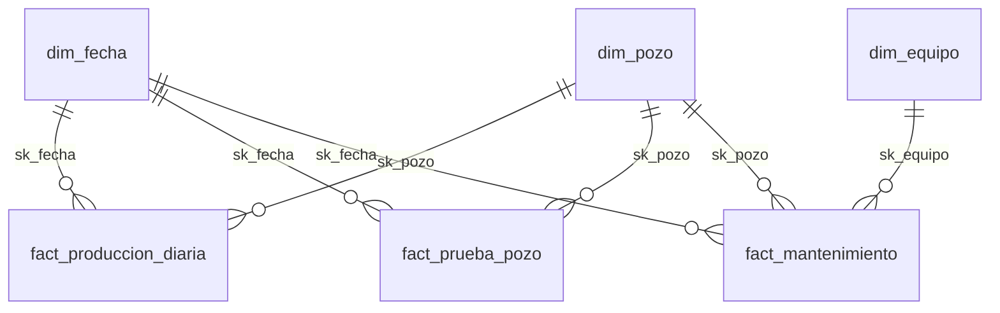
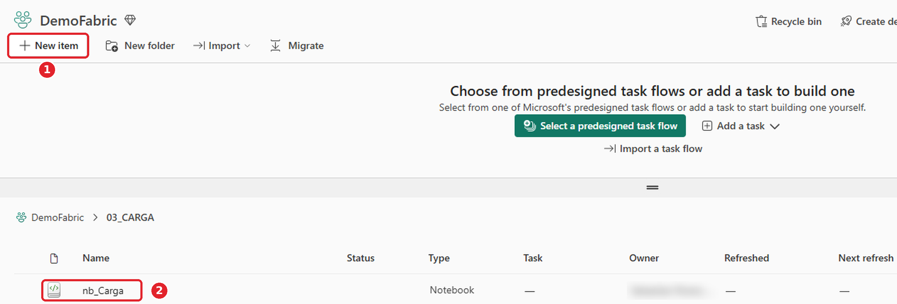

# 📊 Parte 4 · Carga: de Silver a Gold

En esta parte creamos el notebook que toma las tablas limpias de Silver, aplica **reglas de negocio** y deja en Gold un **modelo dimensional** (estrella) listo para Power BI. Igual que en la parte 3, lo dejamos dentro de un pipeline con aviso por correo.

| Paso | Qué haces | Resultado |
|---|---|---|
| [1](#paso-1--crear-el-notebook) | Crear el notebook | `nb_Carga` en la carpeta `03_CARGA` |
| [2](#paso-2--agregar-el-código) | Agregar el código | El notebook con el modelo dimensional |
| [3](#paso-3--ejecutar-y-revisar-el-resultado) | Ejecutar y revisar | 3 dimensiones y 3 hechos en Gold |
| [4](#paso-4--crear-el-pipeline-con-aviso-por-correo) | Crear el pipeline con aviso por correo | `Pipeline_Carga` |

---

## Paso 1 · Crear el notebook

1. Entra a la carpeta **03_CARGA**.
2. Haz clic en **+ New item** ①, busca **Notebook** y llámalo `nb_Carga` ②.

3. Abre el notebook y agrega el lakehouse **Gold** como **lakehouse predeterminado** (**Add data items** → **Existing data sources** → `Gold`).

---

## Paso 2 · Agregar el código

- **Opción A · Pegar el código:** copia todo [`notebooks/nb_Carga.py`](../notebooks/nb_Carga.py) en la primera celda.
- **Opción B · Importar:** en `03_CARGA`, **Import → Notebook → From this computer** → [`notebooks/nb_Carga.ipynb`](../notebooks/nb_Carga.ipynb). Después agrega el lakehouse **Gold**.

**Parámetros:**

| Parámetro | Valor por defecto | Para qué |
|---|---|---|
| `WORKSPACE` | vacío: el workspace actual | Igual que en la parte 3 |
| `LH_SILVER` | `Silver` | Lakehouse de donde se leen las tablas limpias |
| `UMBRAL_DESVIACION_PCT` | `30` | % de diferencia contra la última prueba de pozo que dispara la alerta |

### El modelo

| Tabla | Una fila por… | Columnas principales |
|---|---|---|
| `dim_pozo` | pozo | `clave_pozo`, UWI, nombre, campo, coordenadas, estado, método de levantamiento |
| `dim_equipo` | equipo de bombeo o variador | tipo, fabricante, modelo, potencia, pozo |
| `dim_fecha` | día del año | año, mes, `anio_mes`, día |
| `fact_produccion_diaria` | pozo y día | aceite, agua, gas, BSW, horas, **aceite esperado, desviación y alerta** |
| `fact_prueba_pozo` | prueba de pozo | aceite, agua, BSW recalculado, presión |
| `fact_mantenimiento` | orden de mantenimiento | tipo, estado, costo, duración en días |

Las llaves (`sk_pozo`, `sk_equipo`, `sk_fecha`) son **enteros**: Power BI relaciona y comprime mejor con enteros que con textos.

### La regla de negocio

Para cada pozo y día, el notebook busca la **última prueba de pozo válida** anterior a esa fecha y calcula:

- `aceite_esperado_bbl` = aceite de la prueba × horas operadas / 24
- `desviacion_pct` = (aceite real − esperado) / esperado × 100
- `alerta_desviacion` = 1 si la desviación supera el 30 %

---

## Paso 3 · Ejecutar y revisar el resultado

1. Haz clic en **Run all**.
2. Con los datos del taller, las tablas de Gold quedan así:

| Tabla | Filas |
|---|---|
| `dim_pozo` | 31 |
| `dim_equipo` | 60 |
| `dim_fecha` | 365 |
| `fact_produccion_diaria` | 101 |
| `fact_prueba_pozo` | 184 |
| `fact_mantenimiento` | 141 |

3. La última celda muestra los pozos con alerta. Debe aparecer **GAR-004** los días **17 y 18** (`sk_fecha` 20261117 y 20261118), con una producción cerca de **50 % por debajo** de su última prueba.

> 💬 **Para conversar:** la caída de GAR-004 no es un error de datos: Silver la dejó pasar porque los valores son válidos. La detecta Gold, porque es una **regla de negocio**. ¿Qué otras reglas de negocio de Sierracol vivirían en Gold?

---

## Paso 4 · Crear el pipeline con aviso por correo

Repite el paso 4 de la [parte 3](../03-Transformacion/README.md#paso-4--crear-el-pipeline-con-aviso-por-correo) con estos cambios:

| Qué | Valor |
|---|---|
| Carpeta | `03_CARGA` |
| Nombre del pipeline | `Pipeline_Carga` |
| Notebook de la actividad | `nb_Carga` |
| Body del correo | `@concat('El notebook nb_Carga falló. Ejecución: ', pipeline().RunId, '. Error: ', activity('Notebook1').error.message)` |

---

✅ **Al terminar esta parte tienes:** el modelo dimensional en Gold con la alerta de desviación de producción, y un pipeline que avisa si la carga falla.

➡️ [Parte 5 · Orquestación](../05-Orquestacion/README.md) · ⬅️ [Parte 3 · Transformación](../03-Transformacion/README.md) · [Volver al inicio](../README.md)
