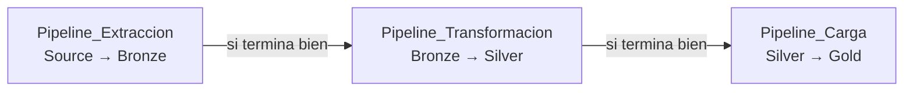
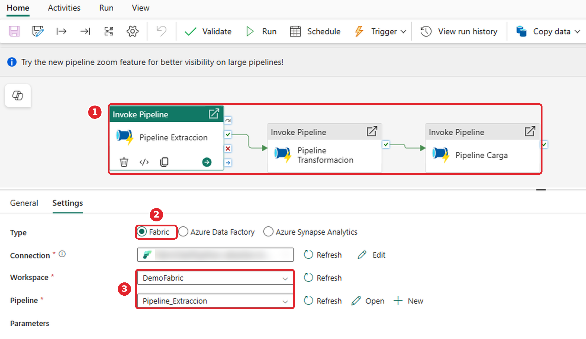

# 🎼 Parte 5 · Orquestación: todo el flujo en un solo pipeline

Hasta ahora tenemos tres pipelines que se ejecutan por separado. En esta parte creamos un **pipeline orquestador** que los ejecuta **en orden**, y solo pasa al siguiente si el anterior terminó bien.

---

## Paso 1 · Crear el pipeline orquestador

1. Entra a la carpeta **00_ORQUESTACION**.
2. Haz clic en **+ New item** → **Pipeline** y llámalo `Pipeline_Orquestador`.

## Paso 2 · Agregar las tres actividades *Invoke pipeline*

1. Agrega tres actividades **Invoke pipeline** ① y nómbralas (pestaña **General**) `Pipeline Extraccion`, `Pipeline Transformacion` y `Pipeline Carga`.
2. Une cada una con la siguiente usando la salida **verde (✓, "On success")**.
3. En la pestaña **Settings** de cada actividad:
   - **Type:** **Fabric** ②.
   - **Connection:** la conexión a pipelines de Fabric (la primera vez se crea iniciando sesión con tu cuenta).
   - **Workspace** y **Pipeline** ③:

| Actividad | Pipeline que invoca |
|---|---|
| `Pipeline Extraccion` | `Pipeline_Extraccion` |
| `Pipeline Transformacion` | `Pipeline_Transformacion` |
| `Pipeline Carga` | `Pipeline_Carga` |

   - Deja marcada la opción **Wait on completion** (esperar a que termine). Si se desmarca, la actividad siguiente arranca sin esperar a que la anterior termine y la transformación podría leer archivos que todavía no llegan.

## Paso 3 · Ejecutar el flujo completo

1. Haz clic en **Save** y luego en **Run**.
2. En el panel **Output**, las tres actividades deben quedar en verde, una después de otra.
3. Comprueba el resultado en cada capa:

| Capa | Dónde mirar | Qué debe haber |
|---|---|---|
| Bronze | Lakehouse `Bronze` → `Files/bronze` | Los 5 CSV |
| Log de extracción | `WH_ControlCargas` → `ControlCargas.TablaLogAuditoria` | 5 filas nuevas con `Succeeded` |
| Silver | Lakehouse `Silver` → `Tables` | Esquemas `openwell`, `sap`, `produccion`, `calidad` |
| Gold | Lakehouse `Gold` → `Tables` | 3 dimensiones y 2 hechos |

## Paso 4 · Programar la ejecución (opcional)

Para que el flujo corra solo, en `Pipeline_Orquestador` haz clic en **Schedule**, activa la programación y elige la frecuencia (por ejemplo, todos los días a las 6:00 a. m., zona horaria de Bogotá).

> **¿Por qué orquestar con un pipeline aparte?** Cada etapa se puede seguir ejecutando y probando sola, y el orquestador solo decide **el orden**. Si mañana se agrega una etapa (por ejemplo, actualizar un modelo semántico), se agrega una actividad más sin tocar las demás.

---

✅ **Al terminar esta parte tienes:** el flujo completo **Source → Bronze → Silver → Gold**, dirigido por la tabla de control, con log de auditoría, cuarentena, avisos por correo y una sola ejecución que lo coordina todo.

⬅️ [Parte 4 · Carga](../04-Carga/README.md) · [Volver al inicio](../README.md)
