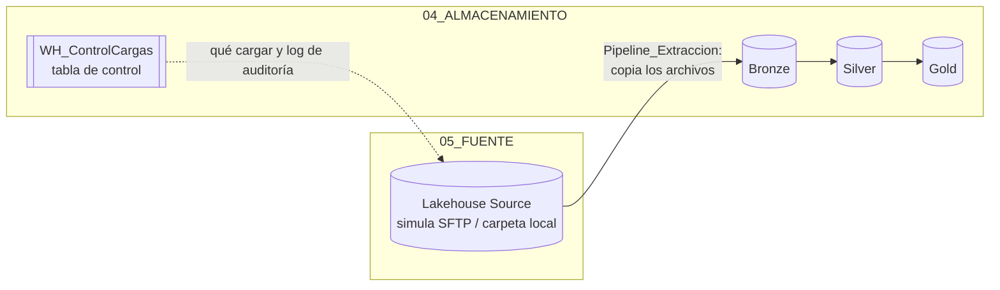

# 🛢️ Taller Microsoft Fabric · OneLake como repositorio único

Guía paso a paso del taller práctico de **ingeniería de datos en Microsoft Fabric**: desde la creación del ambiente hasta un flujo dirigido por una **tabla de control de cargas**, que mueve archivos desde una fuente externa hasta las capas **Bronze → Silver → Gold**.

## 🎯 Qué vas a construir



## 🗺️ Contenido

| Parte | Tema | Estado |
|---|---|---|
| [1 · Preparación del ambiente](01-Preparacion-del-ambiente/README.md) | Workspace, carpetas, lakehouses, warehouse, tabla de control, log de auditoría y archivos fuente | ✅ Disponible |
| [2 · Extracción](02-Extraccion/README.md) | Pipeline que lee la tabla de control, copia de la fuente a Bronze y registra cada copia en el log | ✅ Disponible |
| 3 · Transformación | Notebooks Bronze → Silver (validación y limpieza) y Silver → Gold (modelo dimensional) | 🔜 En construcción |

## 📁 Estructura del repositorio

```
├── 01-Preparacion-del-ambiente/   ← paso a paso de la parte 1
├── 02-Extraccion/                 ← paso a paso de la parte 2
├── img/                           ← capturas de la guía
├── sql/
│   ├── 01_tabla_control_cargas.sql
│   └── 02_log_auditoria.sql
├── pipeline/
│   └── Pipeline_Extraccion.json
└── datos/
    └── fuente/                    ← los 5 archivos CSV que se suben en la parte 1
```

## ✅ Antes de empezar

- Acceso a Microsoft Fabric con una **capacidad** asignada.
- Permiso para crear workspaces (o un workspace ya creado por TI).
- Este repositorio descargado: **Code → Download ZIP**.

> Todos los datos del taller son **sintéticos**: pozos, campos y cifras ficticios.
